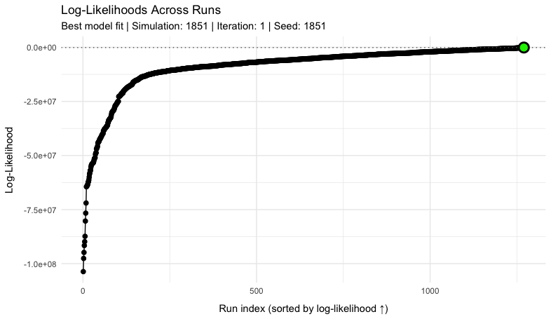

<!-- Google tag (gtag.js) -->
<script async src="https://www.googletagmanager.com/gtag/js?id=G-DKRGVPD7GE"></script>
<script>
window.dataLayer = window.dataLayer || [];
function gtag(){dataLayer.push(arguments);}
gtag('js', new Date());

gtag('config', 'G-DKRGVPD7GE');
</script>

# Model calibration

## Bayesian Likelihood Approach

The MOSAIC framework employs Bayesian inference to calibrate its spatial transmission model. As in many other algorithms that use Bayesian inference, the model systematically estimates parameters based on their ability to recreate the observed data, which is measured through a *likelihood function*. One major assumption of the Bayesian method is that all model parameters---and most importantly, the link between model and data---have a known probability distribution (e.g. Normal, Poisson, Uniform). Therefore, all parameters in the MOSAIC framework have a prior distribution (before model calibration) that is highly informed by other data sources and meta-analyses (see the [Model Description](https://www.mosaicmod.org/model-description.html) page). 

To calibrate the MOSAIC model to observed cholera surveillance data, the algorithm updates prior beliefs about the model parameters through the likelihood function $\mathcal{L}(\boldsymbol{\Theta}) = P(\text{data}\mid\boldsymbol{\Theta})$, the probability of the observed data under the model with parameter vector $\boldsymbol{\Theta}$. This parameter vector includes all quantities required for a single iteration of the model, which includes transmission rates, mobility parameters, and seasonal forcing coefficients for example (see the [Table of Model Parameters](https://www.mosaicmod.org/model-description.html#table-of-model-parameters)).
\begin{equation}
\boldsymbol{\Theta} = \{\, \beta,\, \gamma,\, \omega,\, a_1,\, a_2,\, b_1,\, b_2,\, \dots \, \}
(\#eq:theta)
\end{equation}
During model calibration, we sample the large parameter space of $\boldsymbol{\Theta}$ with a brute‑force random sampling algorithm (more details below) and score every draw by its log-likelihood; the highest-scoring draw is
\begin{equation}
\hat{\boldsymbol{\Theta}} = \underset{\boldsymbol{\Theta}}{\arg\max}\big[\log \mathcal{L}(\boldsymbol{\Theta})\big].
(\#eq:general-likelihood)
\end{equation}

[Bayes' theorem](https://en.wikipedia.org/wiki/Bayes%27_theorem) links the likelihood to the posterior distribution of $\boldsymbol{\Theta}$:
\begin{equation}
P(\boldsymbol{\Theta}\mid\text{data})
=
\frac{P(\text{data}\mid\boldsymbol{\Theta})\,P(\boldsymbol{\Theta})}{P(\text{data})}.
(\#eq:bayes-1)
\end{equation}
The evidence $P(\text{data})$ does not depend on the model parameters, so it is a constant. The prior $P(\boldsymbol{\Theta})$ is informative, not constant, but every draw is sampled from it, so it enters through the sampling rather than through the weights: for a draw $\boldsymbol{\Theta}^{(i)}$ taken from the prior, the importance weight that turns the set of draws into a sample from the posterior is proportional to its likelihood,
\begin{equation}
w_i \;\propto\; \frac{P(\boldsymbol{\Theta}^{(i)}\mid\text{data})}{P(\boldsymbol{\Theta}^{(i)})} \;\propto\; P(\text{data}\mid\boldsymbol{\Theta}^{(i)}).
(\#eq:bayes-2)
\end{equation}
Ranking draws from the prior by their likelihood therefore ranks them by posterior support. How the weights are actually assigned, and how far they depart from these exact importance weights, is described in [Estimating the Posterior Distribution of Model Parameters](#estimating-the-posterior-distribution-of-model-parameters). The likelihood itself is built from the probability density functions $f(y\mid\hat{y})$ as described below.


## Total Log-likelihood for Cases and Deaths

Because every draw is weighted by $P(\text{data}\mid\boldsymbol{\Theta})$, we constructed the likelihood function with
the appropriate distribution for each of the observed data types using common notation for a probability density function $f(y\mid\hat{y})$. The MOSAIC framework is a spatial model, so we also included the $J$ spatial locations and $T$ time points in the full
likelihood, which gives the product over both indices:

\begin{equation}
P\left(\text{data}\mid\boldsymbol{\Theta}\right)
\;=\;
\prod_{j=1}^{J}
\;\prod_{t=1}^{T}
f\!\left(
y_{jt}\;
\bigl|\;
\hat{y}_{jt}\!\left(\boldsymbol{\Theta}\right)
\right),
(\#eq:total-log-likelihood-1)
\end{equation}

where $y_{jt}$ is the observed count (cases, deaths, etc.) for location $j$ at
time $t$, and $\hat{y}_{jt}(\boldsymbol{\Theta})$ is the corresponding model-generated
mean (written $C_{j,t}^{\text{est}}$ for cases below).  Substituting $f(\cdot)$ with the appropriate probability distribution
(Poisson, Negative Binomial, etc.) yields the explicit likelihood function used in
calibration. The model runs on a daily time step, and the surveillance it is fitted to is weekly: each reported weekly total is spread over the seven days of its reporting week (see [Surveillance reconciliation](https://www.mosaicmod.org/data.html#surveillance-reconciliation) on the Data page). By default the cases are scored one day at a time, at a dispersion estimated from weekly totals, and the deaths on reporting-week totals; an alternative rule scores the cases on reporting-week totals as well (see [Weekly scoring of cases](#weekly-scoring-of-cases) below).

The total log-likelihood combines contributions from observed cases and deaths across locations and time points. This combined likelihood function quantifies the probability of the observed epidemiological data given the model parameters $\boldsymbol{\Theta}$.
\begin{equation}
\log \mathcal{L}(\boldsymbol{\Theta}) =
\sum_{j=1}^{J} w_{j} \left[
w_{\text{cases}} \sum_{t=1}^{T} w_{t}\,\log P\left(C_{j,t}^{\text{obs}} \mid C_{j,t}^{\text{est}}(\boldsymbol{\Theta}), k_{\text{cases},j}\right)
+ w_{\text{deaths}}\,\log \mathcal{L}^{\text{deaths}}_{j}(\boldsymbol{\Theta})
\right]
(\#eq:total-log-likelihood-2)
\end{equation}

Where, $C_{j,t}^{\text{obs}}$ is the number of cases observed at location $j$ on day $t$, $C_{j,t}^{\text{est}}(\boldsymbol{\Theta})$ is the simulated reported cases of that day, and the cases sum runs over the days of the scored window that carry a finite observation. The scored window starts after a burn-in of `control$likelihood$burn_in_days` days (30 by default), which keeps the transient of the initial conditions out of the score. Note that each log-likelihood term is weighted three times — by a location weight $w_j$, a time-step weight $w_t$ (which, for deaths, weights the days of each reporting week inside $\log \mathcal{L}^{\text{deaths}}_{j}$), and an outcome-specific weight $w_{\text{cases}}$ or $w_{\text{deaths}}$ — so that contributions reflect data reliability and public-health priorities across space, time, and outcome. Where the surveillance carries per-observation confidence weights, they multiply $w_t$ in the cases term and are then rescaled so that they redistribute, but do not change, the location's total weight. The cases term is a sum of per-day Negative Binomial log-densities at the weekly dispersion $k_{\text{cases},j}$ (`control$likelihood$cases_scoring = "daily"`, the default). This is the cell rule of MOSAIC-pkg v0.100.1 and earlier, but it runs at the dispersion estimated now (from observed weeks under `reported_tier`, and from a cross-country panel trend for a location without a usable estimate of its own), so it does not reproduce the likelihood of a MOSAIC-pkg v0.100.1 run; matching that likelihood also needs the run's `nb_k_cases` and a configuration without `reported_tier`. The deaths term $\log \mathcal{L}^{\text{deaths}}_{j}$ is not a sum of independent weekly densities: it is the marginal likelihood of the weekly observed deaths with the reported case fatality ratio integrated out for each simulated path, as defined in the [Case fatality rate](https://www.mosaicmod.org/model-description.html#case-fatality-rate) section of the model description (a weekly quasi-Poisson score with a per-location dispersion, estimated from the observed weeks where a location has enough of them, and a small background, and a Laplace approximation over a location offset and one deviation per calendar year). Deaths are scored on these weekly totals whichever rule scores the cases. The cases density and how its dispersion is estimated are detailed under [Distributional Assumptions for Likelihood Components](#distributional-assumptions-for-likelihood-components) below.

| Parameter                                   | Description                                                          |
| ------------------------------------------- | -------------------------------------------------------------------- |
| $J$                                         | Number of locations                                                  |
| $T$                                         | Number of time points (days)                                         |
| $C_{j,t}^{\text{obs}}$                      | Observed cases at location $j$ on day $t$                            |
| $C_{j,t}^{\text{est}}(\boldsymbol{\Theta})$ | Model-estimated mean cases at location $j$ on day $t$                |
| $\log \mathcal{L}^{\text{deaths}}_{j}(\boldsymbol{\Theta})$ | Integrated deaths log-likelihood at location $j$ (reported CFR integrated out; see the model description) |
| $w_j$                                       | Location-specific weights (reflecting population or data confidence) |
| $w_t$                                       | Time-specific weights (typically uniform, $w_t=1$)                   |
| $w_{\text{cases}}$                          | Relative weight for cases                                            |
| $w_{\text{deaths}}$                         | Relative weight for deaths                                           |
| $k_{\text{cases}, j}$                       | Negative Binomial dispersion of weekly cases at location $j$, applied to each daily cell by default |

The optional shape terms of the likelihood (peak timing, peak magnitude, cumulative progression and the weighted interval score, all off by default) are added inside the bracket of Equation \@ref(eq:total-log-likelihood-2), each split between cases and deaths by the same outcome weights $w_{\text{cases}}$ and $w_{\text{deaths}}$ and each multiplied by $N_{\text{obs}} / N_{\text{component}}$, where $N_{\text{obs}}$ is the number of daily time steps with at least one observation at the location and $N_{\text{component}}$ is the number of evaluations that shape term makes (peaks, quantiles or cumulative evaluation points). The shape terms read the daily series: the interval-score term evaluates the weekly $k_{\text{cases},j}$ on daily cells, and the cumulative term scores the cumulative cases of a run of days at a size of $k_{\text{cases},j}$ times the number of days, as for a sum of that many daily cells at $k_{\text{cases},j}$. The scaling puts the peak terms, whose helpers return sums over peaks, on the per-day scale of the daily cases term. The scaling does **not** make the weighted interval score and the cumulative term comparable with the core terms: their helpers already average over their quantiles and evaluation points, so with the defaults (five WIS quantile levels and four cumulative fractions) a given weight on those two terms carries $1/5$ and $1/4$ of $N_{\text{obs}}$ times the per-cell value, and changing the number of quantiles or evaluation points changes their influence. When the reported CFR is integrated out of the deaths likelihood, the deaths peak-magnitude, cumulative and WIS terms are dropped. The location, time and outcome weights $w_j, w_t, w_{\text{cases}}, w_{\text{deaths}}$ of Equation \@ref(eq:total-log-likelihood-2) are not rescaled.

### Weekly scoring of cases

With `control$likelihood$cases_scoring = "weekly"` (MOSAIC-pkg v0.101.0) the cases are scored on reporting-week totals instead of daily cells, and the cases sum of Equation \@ref(eq:total-log-likelihood-2) becomes
\begin{equation}
w_{\text{cases}} \sum_{w} \bar{w}_{jw}\,\log P\left(C_{jw}^{\text{obs}} \mid C_{jw}^{\text{est}}(\boldsymbol{\Theta}), k_{\text{cases},j}\right),
(\#eq:weekly-cases)
\end{equation}
where $C_{jw}^{\text{obs}} = \sum_{t \in w} C_{j,t}^{\text{obs}}$ is the number of cases observed at location $j$ in reporting week $w$, $C_{jw}^{\text{est}}(\boldsymbol{\Theta})$ is the same sum of the simulated daily reported cases, $\bar{w}_{jw}$ is the scoring weight of the week, and the sum runs over the scored reporting weeks of location $j$. The reporting weeks are Monday-to-Sunday blocks, the day spans of ISO weeks: the processed surveillance dates every weekly row by its Monday and spreads its total over that Monday to Sunday, so the daily cases of each complete week sum exactly to the reported weekly total. The week boundary is detected per location from the daily series rather than assumed (`est_nb_dispersion()`), and every current MOSAIC location reports Monday to Sunday. These are also the weeks on which $k_{\text{cases},j}$ is estimated and the posterior predictive intervals are drawn, whichever rule scores the cases. A week is scored only when all seven of its days lie inside the scored window and each of them carries a finite observation, a finite confidence weight and a positive time weight $w_t$. A week cut by the start or end of the scored window, or holding a missing day, is therefore not scored, because it is not a weekly total. The weight $\bar{w}_{jw}$ of a scored week is the mean over its seven days of the time weight $w_t$ multiplied by the per-observation confidence weight of the surveillance (which is constant within a reporting week), and the weights of a location's scored weeks are then rescaled so that their total equals the total of the weeks' time weights alone: the confidence weights decide which weeks count most without changing the location's total weight. The cases term of a location counts only when it has at least three scored weeks (a confidence-weight sum of at least three when confidence weights are supplied).

The weekly rule removes an over-count in the daily cells. A weekly series spread over days carries no information within the week, yet the daily rule scores each of its days as its own Negative Binomial cell at the weekly dispersion $k_{\text{cases},j}$, which, for a week with predicted total $\hat{y}_{jw}$, counts the week's information about the epidemic level $7(k_{\text{cases},j} + \hat{y}_{jw})/(7k_{\text{cases},j} + \hat{y}_{jw})$ times: once in the Poisson limit, but a median of 5.4 times across the national calibrations of MOSAIC-pkg v0.100.1. Daily cells also rank draws largely by how their simulated within-week noise compares with a flat spread. Removing the over-count did not, however, improve the fit to the cases. In the pre-registered likelihood test of MOSAIC-pkg v0.101.0 we calibrated Kenya, Zambia, Cameroon and Ghana under both rules (30,000 simulations per country and rule, with the same data, dispersions, intervals and seeds), and weekly scoring did worse on both of the test's measures of the cases fit, each pooled over the four countries: the geometric mean of the cases weighted interval score under weekly relative to daily scoring was 1.068, and the median absolute log bias ratio of the cases was 0.254 under weekly against 0.187 under daily scoring. We therefore keep daily cells as the default. The weekly rule is fully implemented and stays available while we investigate that result.

Under the weekly rule the shape terms keep the definitions given above, except that the cumulative term scores its sums at a size of $k_{\text{cases},j}$ times the number of days divided by 7, since every seven spread days make up one weekly total. Because the weekly cases term does not over-count each week's information, a given shape-term weight weighs several times more against it than against the daily cases term: on the national re-selection pools of the v0.100.1 rehearsal, the spread of the cases score across draws was a median of 4.8 times smaller under weekly scoring (range 1.8 to 6.5) in the countries whose $k_{\text{cases},j}$ did not change between MOSAIC-pkg v0.100.1 and v0.101.0. For the same reason the deaths term, which is weekly under either rule, carries several times more weight against the cases term in ranking draws at the default outcome weights. Neither shift applies under the default daily rule, whose cases score keeps the per-day spread across draws of MOSAIC-pkg v0.100.1, changing only where the dispersion changed.


## Distributional Assumptions for Likelihood Components

For each location $j$ and scored cell (a day, or a reporting week under the weekly rule) the cases density $f\!\left(y_{jt}\mid\hat{y}_{jt}\left(\boldsymbol{\Theta}\right)\right)$ in Equation
\@ref(eq:total-log-likelihood-1) is a *Negative Binomial* with a location-specific dispersion parameter $k_j$ (the $k_{\text{cases},j}$ of Equation \@ref(eq:total-log-likelihood-2)), which reduces to the *Poisson* density when $k_j = \infty$. In the cases term, $y_{jt}$ and $\hat{y}_{jt}$ below stand for a day's observed and predicted cases, $C_{j,t}^{\text{obs}}$ and $C_{j,t}^{\text{est}}$, or, under the weekly rule of Equation \@ref(eq:weekly-cases), for a week's totals $C_{jw}^{\text{obs}}$ and $C_{jw}^{\text{est}}$.

### Negative Binomial density
\begin{equation}
\log P_{\text{NB}}\!\left(y_{jt}\mid\hat{y}_{jt},k_j\right)
\,=\,
\log\Gamma(y_{jt}+k_j)-\log\Gamma(k_j)-\log\Gamma(y_{jt}+1)
+k_j\log\!\left[\tfrac{k_j}{k_j+\hat{y}_{jt}}\right]
+y_{jt}\log\!\left[\tfrac{\hat{y}_{jt}}{k_j+\hat{y}_{jt}}\right]
(\#eq:negbin)
\end{equation}
so that $\mathrm{Var}(y_{jt})=\hat{y}_{jt}+\hat{y}_{jt}^2/k_j$. Every cell is scored through this density with the predicted mean floored at $\max\!\left(10^{-4},\ 0.02\,\bar{y}_{j}\right)$, where $\bar{y}_{j}$ is the location's mean observed daily count over the scored window, or its mean observed weekly count over its scored weeks under the weekly rule (`control$likelihood$eps_rel_cases`), so a cell with observed cases and a zero prediction costs a bounded, data-scaled amount.

The dispersion $k_j$ is a property of the observation process, so it is estimated once per calibration from the observed cases alone (`est_nb_dispersion()`), not from the model-observation mismatch, on the scored window and on the complete reporting weeks defined under [Weekly scoring of cases](#weekly-scoring-of-cases). For each location we model the weekly totals with a spline trend plus seasonal harmonics following the Farrington/Noufaily convention used by the [`surveillance`](https://cran.r-project.org/package=surveillance) package, and estimate $k_j$ by conditional maximum likelihood (`MASS::glm.nb`), honouring the per-observation confidence weights. The estimate is therefore a dispersion of weekly totals, and the default daily rule applies it unchanged to every daily cell. Seven independent daily cells at $k_j$ imply, for a week with predicted total $\hat{y}_{jw}$, a weekly variance of about $\hat{y}_{jw}+\hat{y}_{jw}^2/(7k_j)$, smaller than the $\hat{y}_{jw}+\hat{y}_{jw}^2/k_j$ that the estimate describes: this is the over-count described under [Weekly scoring of cases](#weekly-scoring-of-cases). Under the weekly rule the scored cells are the weekly totals on which $k_j$ is estimated.

Only observed weeks enter the fit. The configuration carries a matrix of surveillance trust tiers aligned with the observations, `reported_tier` (1 observed, 2 reconstructed, 3 imputed; built by `make_config_default.R` from the surveillance processing described under [Surveillance reconciliation](https://www.mosaicmod.org/data.html#surveillance-reconciliation)), and a week enters the fit only when all seven of its days are tier 1. A reconstructed week (part of a WHO multi-week report spread over the weeks it covers) or an imputed one (an annual or other multi-week total spread over weeks by a seasonal template) has a synthetic shape that reads as low noise and would inflate $k_j$. Such weeks leave only the fit: the likelihood still scores them, at their confidence weights. A configuration without `reported_tier` fits every week. A location whose scored weeks, over all tiers, number fewer than 20, hold fewer than 15 cases or include fewer than 5 non-zero weeks takes the Poisson limit.

A location can still have no estimate of its own: when every mean model fails to fit, when the standard error of $k_j$ is not finite, when it has enough weeks over all tiers but too few observed ones (an outbreak known only from a spread multi-week report, for example), or when the fit *collapses*. A collapsed fit is one in which $k_j$ runs to the zero boundary --- a bursty series or a reporting dump defeats the smooth mean, so the count after a run of zero weeks is explained by unbounded overdispersion rather than by the reporting process --- and the estimator detects it by a degenerate standard error, one below $10^{-4}$ times the larger of the estimate and the numerical lower bound $k = 0.1$. Before MOSAIC-pkg v0.101.0 a collapsed fit was reported at that lower bound, the most overdispersed value allowed. A fit clamped at the lower bound is not used either, because the bound is censoring rather than a measurement: where a series' few non-zero observed weeks are mostly the edges of short outbreaks whose middle weeks are reconstructed, and therefore left out of the fit, the smooth mean cannot follow the outbreaks, their variance stays in the residual, and the estimator tends to return the bound whatever the true dispersion (on synthetic series of that shape it did so in more than half of the fits, for a Poisson, a $k = 1$ and a $k = 5$ reporting process alike). Kept at $k = 0.1$, such a location's cases score would be several times less sensitive to the level of its cases than at the panel trend's value, and the predictive median of a weekly total would be zero for any weekly mean up to 102. Since MOSAIC-pkg v0.103.0 a fit whose 95% interval on the log scale reaches the lower bound is treated the same way, because the data cannot tell it from a clamped fit, and without the rule a location's $k_j$ would jump tenfold as its fit crossed the bound. In the default configuration this applies to Uganda, whose own fit is $0.117$ ($0.079$–$0.173$ 95% CI). A location without a usable estimate of its own, whether it has none or its fit is clamped at or near the lower bound, takes a cross-country *panel trend*: a regression of $\log k$ on the logarithm of the mean weekly cases across the locations of the default configuration that have a finite estimate of their own clear of the lower bound, evaluated at the location's mean weekly count. `run_MOSAIC()` supplies this trend at every scale, so a single-country calibration uses it too, and it is re-derived whenever the default configuration is rebuilt.

The locations with usable estimates of their own are then shrunk toward the run's own cross-location mean-dispersion trend in the style of [Love, Huber & Anders 2014](https://doi.org/10.1186/s13059-014-0550-8), with each location's own estimate weighted by its precision (this trend is fitted only when at least five locations carry estimates; otherwise the estimates are used as they are). All-zero and otherwise uninformative series, and dispersion estimates that run to the Poisson boundary, resolve to $k_j = \infty$, i.e. the Poisson density
\begin{equation}
\log P_{\text{Pois}}\!\left(y_{jt}\mid\hat{y}_{jt}\right)
\,=\;
y_{jt}\log\hat{y}_{jt}-\hat{y}_{jt}-\log(y_{jt}!).
(\#eq:poisson)
\end{equation}
The estimates are written to `2_calibration/diagnostics/nb_dispersion.csv`, which records for each location the number of scored weeks left out of its fit as reconstructed or imputed (`n_weeks_excluded`) and whether its $k_j$ came from the panel trend (`panel_trend`; a censored fit keeps its status, `clamped_lower_bound` or `near_lower_bound`, beside it); `summary.json` counts the locations that took the panel trend. These estimates replace an earlier method-of-moments estimate across the whole series, which measured the variance of the epidemic signal rather than the observation dispersion and was held up by a floor ($k \ge 3$) at almost every location; that floor is retired. A dispersion can still be set explicitly with `control$likelihood$nb_k_cases`, which replaces the estimate.

The weighting scheme
$w_j,\,w_t,\,w_{\text{cases}},\,w_{\text{deaths}}$ (introduced in
Equation \@ref(eq:total-log-likelihood-2)) controls the relative influence
of each location, time step, and outcome on the overall fit.


## Algorithm for Parameter Estimation

The MOSAIC calibration relies on a *brute-force random sampling* (BFRS) workflow with importance-sampling for estimating posterior parameter distributions. The BFRS approach is deliberately simple, fully parallelisable, and maps directly onto the informative priors which have been painstakingly estimated a priori (see the [Model Description](https://www.mosaicmod.org/model-description.html) page).  

Unlike [Markov-Chain Monte Carlo](https://en.wikipedia.org/wiki/Markov_chain_Monte_Carlo) (MCMC) sampling methods, the BFRS workflow generates independent parameter draws, so there is no need to worry about convergence diagnostics, burn-in, or autocorrelation, and simulations can be distributed across hundreds of CPUs. The trade-off is efficiency: for a fixed computational budget MCMC can concentrate samples in the highest-posterior region, whereas BFRS spends many draws in moderately likely parts of the space. Although this wastes some compute, the penalty is acceptable because the metapopulation engine (`run_simulation()`, implemented in R) evaluates each $\boldsymbol{\Theta}^{(i)}$ parameter draw in roughly a second for the full 40-location model, and draws are embarrassingly parallel.

Relative to [Latin-hypercube](https://en.wikipedia.org/wiki/Latin_hypercube_sampling#:~:text=Thus%2C%20orthogonal%20sampling%20ensures%20that,of%20random%20numbers%20without%20any) or [Sobol sequence](https://en.wikipedia.org/wiki/Sobol_sequence) sampling designs, which are also intended to do broad surveys of the parameter space, BFRS keeps the exact prior shape, can be extended at any time by simply adding more draws, and feeds directly into likelihood weighting without extra transformations. In combination with the engine's speed, these features make Bayesian calibration in MOSAIC both fast and easily reproducible.

In practice, the BFRS workflow is executed in two phases, and every draw in both phases comes from the prior $P(\boldsymbol{\Theta})$; the phases differ only in how many draws are run, not in where they are drawn. After each batch the stopping rule weights every draw so far by the posterior described in [The coarsened posterior](#the-coarsened-posterior) and computes two quantities on those weights: the per-parameter variance-ratio ESS of [Effective sample size](#effective-sample-size-ess), summarised by the value that a fraction `ESS_param_prop` (default 0.95) of the parameters reach, and the seed-batch ratio of [Seed-batch stability](#seed-batch-stability). The run has converged when that ESS reaches `ESS_param` (default 100), the seed-batch ratio is below `batch_ratio_max` (default 0.2), and at least `min_batches_adaptive` batches have run. An *adaptive phase* runs fixed-size batches (default 500 draws; at least 5 and at most 8 batches). It ends when a growth model of the ESS in the number of draws fits with $R^2 \ge 0.90$ (over at least five batches) or the batch limit is reached. The growth model is a linear and a square-root regression, of which the better fit is used (linear on a tie). Linear is the expected shape: for $n$ independent prior draws the Kish ESS of fixed weights grows as $n\,(\mathbb{E}\,w)^2/\mathbb{E}\,w^2$, and replaying the 2026-10 national runs the coarsened-posterior ESS was linear in $n$ ($R^2$ 0.995--1.000, against 0.955--0.978 for the square root). A *predictive phase* then uses that model to predict how many further draws are needed, runs them in batches (never smaller than the adaptive batch size and at most 10,000 draws each, for at most 10 batches), and re-evaluates after each until the run converges or the total budget (default 100,000 draws) is spent. The ESS can fall when a much better draw arrives, because the weights then concentrate on it; when the growth model does not fit, or predicts no growth, the next batch is the adaptive batch size, still bounded by the per-batch and total caps. Because those fallback batches still count against the predictive phase's 10-batch limit, a run whose ESS keeps jumping can end its predictive phase below the total budget (2 of the 28 national replays stopped at 33,000--36,000 of 50,000 draws); raising `max_batches_predictive` or `batch_size_adaptive` avoids it. Until MOSAIC-pkg 1.3.0 the stopping rule read a kernel-density marginal ESS that was not bounded by the ESS of the weights and could pass on a collapsed posterior (a point mass on a randomly chosen draw of a 50,000-draw run scored 2,518), and it fitted the square-root model unless the linear one was better by 0.03. A calibration can instead be run with a fixed number of draws (`control$calibration$n_simulations`); such a run never evaluates the ESS criterion and reports the status `completed_fixed` (or `completed_fixed_partial` if the posterior-ensemble metrics could not be computed) with `converged = FALSE` and `convergence_evaluated = FALSE`, rather than `completed_unconverged`. Batches are dispatched to a local PSOCK cluster of R worker processes (the `parallel` package); the BLAS and OpenMP thread-count environment variables are pinned to 1 in each worker so that parallel workers do not oversubscribe the cores.

The steps below summarise how this BFRS workflow is turned into a practical calibration routine—moving from prior draws, through model simulation and likelihood evaluation, to the identification of the best-fitting parameter set.

1. *Generate reproducible parameter sample*

Draw $n_{\text{sim}}$ independent parameter vectors $\boldsymbol{\Theta}^{(i)} \sim P(\boldsymbol{\Theta})$ using predetermined random seeds, ensuring that the calibration can be rerun and audited exactly.

2. *Forward-simulate* 

The transitions between most model compartments are stochastic, so for each independent sampling of the parameter space $\boldsymbol{\Theta}^{(i)}$, we run the stochastic transmission model for $n_{\text{iter}}$ internal iterations.

3. *Evaluate the fit for every draw*

For each of the $n_{\text{sim}} \times n_{\text{iter}}$ internal iterations, compute the total log-likelihood via Equation \@ref(eq:total-log-likelihood-2), and combine the $n_{\text{iter}}$ values of each draw into $\log\mathcal{L}(\boldsymbol{\Theta}^{(i)})$ by their log-mean-exp, i.e. the log of the likelihood averaged over the stochastic iterations.

4. *Posterior summaries and representative-model selection*

After all $n_{\text{sim}}$ parameter vectors have been scored, the calibration pipeline produces three complementary summaries: the posterior parameter distributions and two predictive representations.

- *Posterior parameter distributions* --- the marginal posterior summaries of each model parameter (Equation \@ref(eq:weighted-posterior)) are weighted summaries over exactly the draws the predictions use: the ensemble members, a resample of the coarsened posterior (Equation \@ref(eq:coarsened-weights)) weighted by their counts, or the optimised subset when `optimize_subset = TRUE`. These are reported in `posterior_quantiles.csv`, `posteriors.json` and `parameter_estimates.csv`, drawn in the prior/posterior diagnostic plots and form the substrate for all downstream forecasts. Under the legacy weighting schemes (`control$targets$best_subset_weighting = "saturated"`, the default before MOSAIC-pkg 1.3.0, or `"tempered"`) the members are the best subset instead, at the weights of Equation \@ref(eq:aic-weights).

- *Ensemble forecast* --- for each of $n_{\text{iter}}^{\text{ens}}$ stochastic realisations per parameter vector (default 10), the model is simulated forward and the per-trajectory predictions are aggregated by their importance weights to produce a posterior predictive ensemble. This is the default representation for probabilistic forecasts; its intervals include observation noise at the dispersions the likelihood scored with (see [Posterior predictive intervals](#posterior-predictive-intervals) below).

- *Medoid representative model* --- a single parameter vector is also selected for scenario analysis. The *medoid model* is the ensemble member whose predicted cases trajectory (the median over its stochastic runs of its engine-level trajectories, before observation noise) is closest, in mean absolute error of $\log(1 + \text{cases})$, to the ensemble's central cases trajectory (the weighted median by default), so that the representative tracks the reported curve. The distance is pooled over every location and every scored time step (the burn-in and the engine's artifact-masked steps are excluded), so in a multi-location calibration every location counts and a single location is not allowed to stand for the whole network; for a single-location run it reduces to that location's log-scale error. The distance uses cases only. Its configuration, with the reported case fatality ratio shifted to the medoid's own posterior, is saved as `config_medoid.json` and simulated for $n_{\text{iter}}^{\text{best}}$ stochastic realisations (default 100), so its reported coverage is directly comparable to the ensemble. A best-likelihood configuration is not produced; the highest-likelihood draw is only flagged in the sample table.

Both predictive representations, the ensemble and the medoid, report $R^2$ and the bias ratio from the central line of their respective stochastic trajectories rather than from a separate deterministic simulation, so they are directly comparable across the prediction set; both statistics are computed on the scored window only. By default the central line is the weighted median for cases and the weighted mean for deaths (`control$predictions$central_method`, which takes one value for both outcomes or one per outcome). The median is the typical trajectory and is robust to a few explosive members; the mean is the expected count, which, unlike the median, does not collapse to zero on most days of a sparse deaths series. Both outcomes used the weighted mean from MOSAIC-pkg v0.98.0 to v0.100.x, and the weighted median from v0.46.1 to v0.97.x. Either way, the central line summarises the engine-level member trajectories (see [Posterior predictive intervals](#posterior-predictive-intervals) below). In the ensemble, each member's deaths are redrawn from the posterior of the reported case fatality ratio given that member's path, and forecast years carry the ensemble's shared latest-year CFR shift (see the [Case fatality rate](https://www.mosaicmod.org/model-description.html#case-fatality-rate) section). The ensemble members are a sampling-importance-resample of the posterior, drawn after sampling has finished: $K$ draws are resampled systematically, in proportion to $\tilde w_i$, and duplicates are collapsed into one member weighted by its count over $K$ (see [The coarsened posterior](#the-coarsened-posterior)). No further calibration simulations are run for this step. The optional subset optimisation (`control$predictions$optimize_subset`; off by default since MOSAIC-pkg 1.3.0, on in 1.2.x) then picks, among the top-$N$ members by likelihood, the $N$ whose ensemble best fits the data, with the members' count weights renormalised over the top $N$; that subset then drives the ensemble, the medoid, the trajectories and the parameter posterior. It is off by default because, under the coarsened posterior, it re-truncates the resampled members to the upper tail of the likelihood using the training data (in a national run it reduced 252 members to 38). Under the legacy schemes the members are instead the best subset of a tiered grid search over subset sizes, which seeks a subset meeting $\text{ESS}_{\text{best}} = 100$, $A_{\text{best}} = 0.70$ and $\mathrm{CV}_{\tilde w,\text{best}} = 1.0$, relaxing the targets through a sequence of tiers (`get_default_subset_tiers()`) until one is met (see Stage 1 below), and the optimised subset drives the parameter posterior as well.

### Posterior predictive intervals

The member trajectories of the ensemble are draws of the transmission model: they carry its process noise, including the binomial stages of the reporting process, but not the observation noise that the likelihood assumes when it scores those trajectories against surveillance. Intervals built from them alone are therefore too narrow for the observed counts. Since MOSAIC-pkg v0.101.0, `calc_model_ensemble()` draws, for every member trajectory, an observation from a weekly observation model at the dispersions the likelihood scored with (argument `observation_model`, which `run_MOSAIC()` fills with those dispersions), so the intervals of the ensemble and of the medoid are posterior predictive intervals for the *observed* counts:

- *Cases.* Each reporting-week total is drawn from a Negative Binomial around the member's weekly total with the dispersion $k_{\text{cases},j}$ that the likelihood scored with (a Poisson when $k_{\text{cases},j} = \infty$), on the reporting weeks on which that dispersion is estimated (partial weeks at the ends of the window included). The drawn total is apportioned to the days of the week in proportion to the member's daily cases, in whole counts: each day receives within one case of its exact share and that share in expectation, and the weekly total is kept exactly. The draw is the same whichever rule scored the cases. Under the weekly rule it is the likelihood's own observation model. Under the default daily rule, whose seven independent daily cells at $k_{\text{cases},j}$ imply a weekly variance of about $\hat{y}_{jw}+\hat{y}_{jw}^2/(7k_{\text{cases},j})$, the intervals are wider than the likelihood implies, because the draw keeps the variance $\hat{y}_{jw}+\hat{y}_{jw}^2/k_{\text{cases},j}$ of the weekly totals on which the dispersion is estimated.
- *Deaths.* Each reporting-week total is drawn with mean equal to the member's expected reported deaths, given its onsets and its draw of the reported CFR, and with variance $\varphi_j$ times that mean, the quasi-Poisson dispersion of the integrated deaths likelihood (see the [Case fatality rate](https://www.mosaicmod.org/model-description.html#case-fatality-rate) section of the model description). Where $\varphi_j = 1$ the member's deaths are kept as drawn, since they already carry the Poisson part of that variance.

Neither of the likelihood's floors (the floor on the predicted cases and the background on the expected deaths) is part of the predictive: they price a zero prediction in the score and are not a data-generating process. The central lines stay engine-level, computed from the member trajectories before observation noise. The observation noise is mean-preserving given each member, so the weighted mean of the member trajectories is the exact predictive mean, without the Monte Carlo error of the noise; and a weighted median of the observation-level draws would collapse toward zero wherever $k_{\text{cases},j}$ is small, whereas the median of the member trajectories remains the central trajectory. The medoid selection, the trajectory summaries, the implied CFR, the optional subset optimisation and the effective reproductive numbers likewise read the engine-level trajectories. The median of the observation-level draws is reported alongside (`predictive_median`, and `pred_median_obs` in `run_rolling_cv()`) for interval scores such as the weighted interval score, which pair a median with the intervals; it is also the `predicted_median` column of the exported prediction CSVs, so that column and the interval columns come from the same draws, while the engine-level central line is `predicted_central`. Where the reporting dispersion is small ($k_{\text{cases},j}$ well below 1), the observation-level predictive distribution is strongly skewed towards zero, and the engine-level central line can lie above the 50% interval on many days; the figure captions say so. On the national calibrations of the MOSAIC-pkg v0.100.1 rehearsal, the observation-level intervals raised the median weekly coverage of the observed cases from 0.865 to 0.992 for the 95% interval and from 0.365 to 0.698 for the 50% interval, both now above their nominal levels. An ensemble built without an observation model keeps engine-level intervals.


## Estimating the Posterior Distribution of Model Parameters

To transform the BFRS ensemble of samples from the parameter space and corresponding likelihood values
$\bigl\{\boldsymbol{\Theta}^{(i)},\,\log\mathcal{L}(\boldsymbol{\Theta}^{(i)})\bigr\}_{i=1}^{n_{\text{sim}}}$ into a posterior, we use Importance Sampling (IS), a well-known technique originally described by [Kahn & Marshall 1953](https://pubsonline.informs.org/doi/10.1287/opre.1.5.263) and reviewed in a more modern context by [Tokdar & Kass 2010](https://doi.org/10.1002/wics.56). Because the draws come from the prior, the importance weight of a draw is its (tempered) likelihood. Since MOSAIC-pkg 1.3.0 the posterior is, by default, the coarsened posterior described below: every draw with a finite likelihood carries a weight, and the learning rate of the likelihood is declared in advance. The best-subset weighting used before 1.3.0 remains available for reproducing older runs and is described afterwards.

### Compute $\Delta \text{AIC}$ for every draw

For any model, the [Akaike Information Criterion](https://en.wikipedia.org/wiki/Akaike_information_criterion) is $\text{AIC} \;=\; 2k \;-\; 2\log\mathcal{L}$, where $k$ is the number of estimated parameters. Because every MOSAIC simulation has the same $k$, the $\Delta \text{AIC}$ of draw $i$ relative to the best draw is determined solely by the difference in log-likelihood.
\begin{equation}
\Delta_i
\;=\;
\text{AIC}_i - \text{AIC}_{\text{min}}
\;=\;
-\,2\!\left[\log\mathcal{L}(\boldsymbol{\Theta}^{(i)}) -
\log\mathcal{L}_{\max}\right]
(\#eq:aic-delta)
\end{equation}

### The coarsened posterior {#the-coarsened-posterior}

The default posterior (`control$targets$best_subset_weighting = "coarsened"`) weights every draw with a finite log-likelihood by
\begin{equation}
\tilde w_i \;=\;
\frac{\exp\!\big\{\eta\,[\log\mathcal{L}(\boldsymbol{\Theta}^{(i)}) - \log\mathcal{L}_{\max}]\big\}}
     {\sum_{j}\exp\!\big\{\eta\,[\log\mathcal{L}(\boldsymbol{\Theta}^{(j)}) - \log\mathcal{L}_{\max}]\big\}}
\;=\;
\frac{e^{-\eta\,\Delta_i/2}}{\sum_j e^{-\eta\,\Delta_j/2}},
\qquad
\eta \;=\; \frac{\alpha}{n_{\text{obs}}},
(\#eq:coarsened-weights)
\end{equation}
where $n_{\text{obs}}$ is the number of scored observation cells (location-days with a finite reported-cases or reported-deaths observation inside the scored window, after the burn-in) and $\alpha$ is `control$targets$coarsening_alpha` (default 10). Because the draws come from the prior, these weights are self-normalised importance weights for
$$
\pi_\eta(\boldsymbol{\Theta}) \;\propto\; P(\boldsymbol{\Theta})\,\mathcal{L}(\boldsymbol{\Theta})^{\eta},
$$
which is the generalised-Bayes (Gibbs) posterior of [Bissiri, Holmes & Walker 2016](https://doi.org/10.1111/rssb.12158) with the negative log-likelihood as loss and learning rate $\eta$, and the coarsened posterior of [Miller & Dunson 2019](https://doi.org/10.1080/01621459.2018.1469995) with $\alpha$ effective independent observations. $\eta$ is fixed before the weights are seen, so the posterior is declared, not tuned to the draws, and it is sample-coherent: the weight ratio of two draws, $e^{\eta(\log\mathcal{L}_i - \log\mathcal{L}_k)}$, does not depend on the other draws. The weights are stored as `weight_all` in `samples.parquet`.

The untempered posterior, $\eta = 1$, is not a usable target at MOSAIC's data scale, whatever the fit. On the 2026-10 national calibrations three facts settle this. (i) The log-likelihood of a draw is a Monte Carlo estimate: its seed-to-seed SD at fixed parameters is 30--97 log units (12--36 after the log-mean-exp over five stochastic iterations), so at $\eta = 1$ the noise alone collapses 50,000 draws of one identical parameter set onto a single draw. (ii) The daily cases cells count each weekly report 4--6.5 times, and the residuals stay correlated across weeks (integrated autocorrelation times of 12--93 days), so the effective number of independent observations is tens to a few hundred, not the $\sim$3,000 scored cells. (iii) Concentrating harder made the in-sample predictions worse. The ESS of the $\eta = 1$ weights is therefore about 1 in every run; it is kept in `convergence_diagnostics.json` (`likelihood_concentration`) as a measure of how sharply the raw likelihood ranks the draws and is not a fit or convergence diagnostic.

With $\alpha = 10$ the 28 national calibrations of 2026-10 (50,000 draws each) have a coarsened-posterior Kish ESS of 110--4,200 (7,400 for Burkina Faso, whose likelihood is nearly flat), and their pre-1.3.0 saturated subsets corresponded to an $\alpha$ of roughly 6--20. $\alpha$ is a modelling choice: the number of independent observations the likelihood is trusted with. Its value is provisional pending out-of-sample validation (rolling-origin cross-validation, `run_rolling_cv()`). $n_{\text{obs}}$ counts location-days under either cases rule, so under `cases_scoring = "weekly"`, whose log-likelihood sums about one-seventh as many cases cells, the same $\alpha$ gives a flatter posterior.

**Posterior summaries.** As under every weighting scheme, the marginal posterior of each parameter (Equation \@ref(eq:weighted-posterior)) is computed from exactly the draws the predictions use: the resampled ensemble members below, at their count weights, or the optimised subset when `optimize_subset = TRUE`. `posterior_quantiles.csv`, `posteriors.json`, `parameter_estimates.csv` and the prior/posterior plots all use them. The all-draws weights $\tilde w$ (`weight_all`) are the posterior those members are resampled from; they feed the weight health, the auto-mode stopping rule and `parameter_ess.csv`.

**Ensemble members.** The ensemble, the medoid, the subset optimiser and the trajectory summaries need a modest number of members, each simulated $n_{\text{iter}}^{\text{ens}}$ times. They are a sampling-importance-resample of the posterior. $K = \min\{\max[\mathrm{round}(\widehat{\text{ESS}}), K_{\min}], K_{\max}\}$ draws are resampled systematically ([Kitagawa 1996](https://doi.org/10.1080/10618600.1996.10474692)): with one uniform offset $u$, the positions $(u + k)/K$, $k = 0, \dots, K-1$, select draw $i$ either $\lfloor K\tilde w_i \rfloor$ or $\lceil K\tilde w_i \rceil$ times. Here $\widehat{\text{ESS}}$ is the Kish ESS of $\tilde w$ (Equation \@ref(eq:ess)), $K_{\min}$ is `min_best_subset` (default 30) and $K_{\max}$ is the smaller of `max_best_subset` (default 1,000) and `max_ensemble_members` (default 300; the ensemble arrays grow linearly with $K$ and the optional subset optimiser roughly quadratically, so the cap keeps the ensemble at most about 2.8 times the $\sim$108 members of the pre-1.3.0 saturated subset), and the offset is drawn from a seed fixed by the configuration's seed, so the resample is reproducible. Duplicates are collapsed into one member weighted by its count over $K$; these members and weights are the `is_best_subset` and `weight_best` columns of `samples.parquet`. No tier search is run, and the targets $\text{ESS}_{\text{best}}$, $A_{\text{best}}$ and $\mathrm{CV}_{\tilde w,\text{best}}$ are not used.

### Seed-batch stability {#seed-batch-stability}

Draw $i$ is sampled with seed $i$, so the draws split into $B = 10$ disjoint, independent sub-runs by $(i - 1) \bmod B$. For each parameter, the seed-batch ratio is the standard deviation, across the batches that carry weight, of the within-batch $\tilde w$-weighted means, divided by the posterior standard deviation from all draws. The reported value is the largest over the parameters. For a posterior with Kish ESS $E$ it is roughly $\sqrt{B/E}$ for one parameter, and the maximum over parameters is about $1.5\sqrt{B/E}$ for $\sim$40 parameters ($1.8\sqrt{B/E}$ for $\sim$1,500), so the limit of 0.2 (`control$targets$batch_ratio_max`) corresponds to a Kish ESS of roughly 560 (about 800 on a continental run). The ratio is therefore mostly a restatement of the ESS; with the default `ESS_param` of 100 it is the binding criterion. It is part of the auto-mode stopping rule and of the weight-health verdict below.

### Weight health

`calc_weight_health()` (and `calc_run_weight_health()`, which recomputes it for a finished run directory) reports in `summary.json`: the coarsened posterior's Kish ESS (`ess_coarsened`) and seed-batch ratio, the weights the parameter posterior is built from (`weights_used_*`: the members' `weight_best`, with the resample's `resample_K` and `resample_n_unique` under `"coarsened"`, or `weight_best_opt` after the optimiser), and the supported resolution $\eta^{\ast}$, the largest learning rate at which the draws still give an ESS of `ESS_param` and a batch ratio below the limit ($n_{\text{obs}}\eta^{\ast}$ is the number of effective observations the draws can resolve). `weight_health_status` is `"ok"` when the coarsened posterior has Kish ESS $\ge$ `ESS_param` and a seed-batch ratio below `batch_ratio_max`; under `"coarsened"` this is `posthoc_criteria_met` and the gated rows of the convergence-status table.

### Legacy best-subset weights

Before MOSAIC-pkg 1.3.0 the posterior weighted a best subset of the draws. The scheme remains available (`best_subset_weighting = "saturated"`, or `"tempered"`), and a run with `"saturated"` reproduces the 1.2.1 posterior, ensemble and medoid exactly; the rest of this subsection describes it. Since the BFRS method generates a large ensemble of candidate parameter sets $\boldsymbol{\Theta}^{(i)}$, the legacy scheme reduces the influence of poorly fitting models before forming the posterior, in **two stages**: a rank-based selection of the best subset, followed by a *saturating* Gibbs weighting within it.

**Stage 1 --- rank-based subset selection.** The retained best subset $\mathcal{B}$ is the top $q$ draws by log-likelihood, where $q$ is chosen by a tiered search (`get_default_subset_tiers()`) subject to $|\mathcal{B}| \ge \text{ESS}_{\text{best}}$ and the agreement/CV targets below, each candidate $q$ being scored on the Stage 2 weights of its own subset (saturated or tempered, as set by `control$targets$best_subset_weighting`; the scheme is used for the tier search, the subset optimizer and the posterior alike). It is a **rank** criterion, not a threshold on $\Delta_i$. Because the saturated weights are nearly flat, in practice the ESS target alone sets $q$ and the agreement and CV targets rarely bind.

**Stage 2 --- saturating weights within the subset.** For $i \in \mathcal{B}$ we compute

\begin{equation}
w_i^{\text{raw}} \;=\; \exp\!\left[-\tfrac12 \min(\Delta_i,\, \Delta^{\ast})\right],
\qquad \Delta^{\ast} = 4,
\qquad \text{and then normalise:} \qquad
\tilde{w}_i \;=\;
\dfrac{w_i^{\text{raw}}}{\displaystyle\sum_{j\in\mathcal{B}} w_j^{\text{raw}}}.
(\#eq:aic-weights)
\end{equation}

Note the $\min(\cdot)$: $\Delta_i$ is **saturated** at $\Delta^{\ast}=4$, not cut off. Every draw beyond $\Delta^{\ast}$ receives the same non-zero weight $e^{-2}$, so all weights lie in $[e^{-2}, 1]$ and the ratio between the best and worst retained draw can never exceed $e^{2} \approx 7.39$.

#### Why not the textbook $\Delta \le 6$ cut-off? {-}

Earlier versions of this document specified a hard cut-off, $w_i^{\text{raw}} = 0$ for $\Delta_i > 6$, on the standard model-selection argument (Burnham & Anderson [2002](https://doi.org/10.1007/b97636), [2004](https://journals.sagepub.com/doi/abs/10.1177/0049124104268644)) that $\Delta_i \le 6$ corresponds to a likelihood ratio of roughly $0.05$. **That rule is not applicable at MOSAIC's data scale, and is not what the pipeline implements.**

The $\Delta \le 6$ heuristic is calibrated for comparing a handful of *fitted* models, each evaluated at its own maximum-likelihood estimate, where $\Delta$ is naturally of order unity. MOSAIC instead scores *unfitted prior draws* against a time-series likelihood summed over tens of thousands of cells (40 locations, with on average $\sim$1,900 observed daily cases cells and $\sim$220 weekly deaths totals each in the default 2018--2027 window). Log-likelihood differences between prior draws are then many orders of magnitude larger than 6, and essentially no draw other than the single best falls within 6 AIC units.

This is not hypothetical. In a reference 100,000-draw calibration over all 40 locations, the median $\Delta_i$ was $9.6 \times 10^5$ and the maximum $1.4 \times 10^7$; **exactly one draw** satisfied $\Delta_i \le 6$. Applying the documented cut-off would therefore place the entire posterior on a single parameter vector, yielding degenerate credible intervals. Saturating at $\Delta^{\ast}$ is what keeps the posterior non-degenerate. That calibration scored cases on daily cells, as the default rule still does. The weekly rule described under [Weekly scoring of cases](#weekly-scoring-of-cases) removes the over-count of each week's information, which would shrink such differences by roughly that factor (a median of 5.4 on the v0.100.1 national calibrations); differences of the size measured here would still be far above 6.

#### What the saturation does and does not buy {-}

The saturation should be understood as **deliberate regularisation, not as importance sampling.** Two consequences follow directly and are reported rather than hidden:

1. *Within the subset, the likelihood is used mainly to rank, not to weight.* Because weights are confined to $[e^{-2},1]$, the subset posterior is close to uniform over $\mathcal{B}$. In the reference run above, the single best draw carried $6.1\%$ of the mass while the remaining 114 draws each carried $0.82\%$ against $0.87\%$ for exact uniformity. The resulting estimator is closer in spirit to approximate Bayesian computation with a rank-based acceptance threshold than to importance sampling.

2. *The convergence metrics below are inflated by construction.* $\widehat{\text{ESS}}$, $A$ and $\mathrm{CV}_{\tilde w}$ are all computed on these saturated weights. Since $\widehat{\text{ESS}}$ is maximised by uniform weights, saturation *raises* it: for weights bounded in $[e^{-2},1]$, $\widehat{\text{ESS}} \gtrsim 0.42\,|\mathcal{B}|$ (Kish) or $0.62\,|\mathcal{B}|$ (perplexity) **regardless of how poorly the draws fit**. These metrics therefore measure the weighting scheme at least as much as they measure the fit, and they cannot be read as evidence that the importance sampler has explored the posterior.

Because of point 2, the subset metrics cannot show whether the draws represent any posterior. MOSAIC-pkg 1.2.x reported the exact, untruncated importance-sampling diagnostics alongside them (`ess_is_all`, `khat_all`), which on the reference run gave an ESS of $1.00$ against $\text{ESS}_B = 107.5$. Since 1.3.0 those $\eta = 1$ numbers are kept only in `convergence_diagnostics.json` as a likelihood-concentration measure (they are about 1 for any informative stochastic likelihood, see [The coarsened posterior](#the-coarsened-posterior)), and the weight health of the coarsened posterior is reported instead, under every scheme.

A `tempered` alternative to Stage 2 is available (`control$targets$best_subset_weighting = "tempered"`), which selects the inverse temperature adaptively so that the worst retained draw sits at a specified weight floor rather than saturating at a fixed $\Delta^{\ast}$. It does preserve the likelihood ordering within $\mathcal{B}$ faithfully (rank correlation between weight and log-likelihood 1.00, against 0.16 for the saturated scheme). **But it is SHARPER than the default, not softer**, and should not be enabled expecting a gentler weighting: $w_{\text{gibbs}}$ is derived from $\max(\Delta)$ *within the set it is applied to*, and inside $\mathcal{B}$ that maximum is ~$4\times10^{3}$ rather than the ~$2.9\times10^{6}$ seen across all draws, making the inverse temperature roughly 680 times larger. Measured on a 25,000-draw Ethiopia run it moves $\widehat{\text{ESS}}$ from 107.5 to **1.25**, with 96% of the posterior mass on a single draw. Because its inverse temperature is rescaled to each candidate subset's own $\Delta$ range, its ESS grows only roughly in proportion to the subset size (about $0.06\,|\mathcal{B}|$ when $\Delta$ rises linearly with rank), so the tier search meets its targets, if at all, at a much larger subset than under the saturated scheme. When selected, the tempered weights are used for the posterior summaries and the ensemble, not only for the convergence gate.

### Posterior summaries

Under the default coarsened posterior the weights $\tilde w$ of Equation \@ref(eq:coarsened-weights) are self-normalised importance weights for $\pi_\eta(\boldsymbol{\Theta})$ over all $n_{\text{sim}}$ draws, and the ensemble members are a systematic resample of them, so the summaries below, computed over the members at their count weights, are sampling-importance-resampling estimates of that posterior, with Monte Carlo error governed by its ESS and by $K$. Under the legacy schemes the weights of Equation \@ref(eq:aic-weights) are **not** proportional to any posterior density: within $\mathcal{B}$ the true density ratio between the best and worst retained draw spans many orders of magnitude --- measured at $\exp(-52{,}263)$ on a reference 100,000-draw run --- while the saturation caps the weight ratio at $e^{2}\approx 7.39$, so the summaries are a weighted empirical summary over the retained subset, closer to an approximate-Bayesian-computation posterior with a rank-based acceptance rule. With that reading in place, we summarise each fitted parameter as a weighted empirical statistic. Take for example the scalar $\sigma$, which gives the proportion of infections that are symptomatic. It is an element of each $\boldsymbol{\Theta}^{(i)}$ sample of the parameter space, so $\bigl\{\sigma^{(i)}\bigr\}_{i=1}^{n_{\text{sim}}}$ gives all $\sigma$ values for which a likelihood has been calculated. Therefore, we derive the posterior mean and 95% credible intervals for $\sigma$ as:
\begin{equation}
\mathbb{E}[\sigma] \;=\; \sum_{i=1}^{n_{\text{sim}}} \tilde{w}_i\,\sigma^{(i)}
\qquad \text{and} \qquad
95\% \, \text{CI} \;=\; \left[\,Q^{(\tilde{w})}_{0.025},\; Q^{(\tilde{w})}_{0.975}\right].
(\#eq:weighted-posterior)
\end{equation}
Where $Q^{(\tilde{w})}_{p}$ denotes the weighted $p$-th quantile over the draws the predictions use (the resampled members at count weights under the coarsened posterior, the best subset under the legacy schemes, or the optimised subset when `optimize_subset = TRUE`).


## Model convergence

Because the MOSAIC framework uses an i.i.d. brute-force random sampling (BFRS) scheme for model fitting, traditional chain-based diagnostics such as $\hat R$ are not relevant. The question is instead whether the draws represent the posterior well enough to trust its summaries. Under the default coarsened posterior this is judged on its own weights, by three statistics:

1. **Effective sample size** of the posterior, $\widehat{\text{ESS}}$ (Equation \@ref(eq:ess)), gated at $\ge$ `ESS_param` in the weight-health verdict;
2. **Per-parameter variance-ratio ESS**, which drives the auto-mode stopping rule; and
3. **Seed-batch stability** ([above](#seed-batch-stability)), gated at a ratio below `batch_ratio_max`.

Under the legacy best-subset schemes the gate is instead three statistics of the subset weights: $\text{ESS}_B$, the agreement index $A$ and the coefficient of variation of the weights $\mathrm{CV}_{\tilde w}$, described below.


### Effective sample size (ESS)
Since the BFRS draws are independent of $P(\boldsymbol{\Theta})$, ESS plays
the role that $\hat R$ does in MCMC. We employ the specification of the ESS in [Elvira *et al.* 2022](https://onlinelibrary.wiley.com/doi/10.1111/insr.12500). Applied to the coarsened-posterior weights of Equation \@ref(eq:coarsened-weights) it yields the posterior ESS (`ess_coarsened`); applied to the legacy subset weights of Equation \@ref(eq:aic-weights) it yields $\text{ESS}_B$; applied to the raw untempered ratios it yields the $\eta = 1$ likelihood-concentration ESS, which is about 1 whatever the fit. All use:
\begin{equation}
\widehat{\text{ESS}} =
\left[
\sum_{i=1}^{n_{\text{sim}}} \tilde{w}_i^{\,2}
\right]^{-1}.
(\#eq:ess)
\end{equation}
Equation \@ref(eq:ess) is the Kish form (`control$targets$ESS_method = "kish"`). The default, `"perplexity"`, is the exponential of the weight entropy, $\exp\!\big(-\sum_i \tilde{w}_i \log \tilde{w}_i\big)$, which is never smaller than the Kish value; it applies to $\text{ESS}_B$ and the $\eta = 1$ ESS. The posterior ESS of the coarsened posterior, which also sets the number of resampled ensemble members, is always the Kish form.
Under the legacy schemes draws outside $\mathcal{B}$ have $\tilde{w}_i=0$, so $\text{ESS}_B$ reflects only the retained
subset, and --- as noted above --- is bounded below by roughly $0.42|\mathcal{B}|$ by the saturation alone. For importance-sampling–style weighting in moderate-dimensional parameter spaces, an ESS in the low thousands is a reasonable working target for stable marginal posterior medians and 95% credible intervals ([Elvira *et al.* 2022](https://onlinelibrary.wiley.com/doi/10.1111/insr.12500); see also the MCMC-context discussion of ESS thresholds in [Gelman *et al.* 2014](https://sites.stat.columbia.edu/gelman/book/) and [Bürkner 2017](https://www.jstatsoft.org/article/view/v080i01)). The earlier MOSAIC guidance of $\widehat{\text{ESS}} \gtrsim 500$–$1000$ tracks these MCMC heuristics; we additionally inspect the per-parameter ESS (below) and the seed-batch stability.

The aggregate $\widehat{\text{ESS}}$ above measures the joint information retained across the full parameter vector $\boldsymbol{\Theta}$. To diagnose whether the posterior on any *individual* parameter is well supported, we also compute a per-parameter ESS (`calc_model_ess_parameter()`): a variance-ratio (delta-method) ESS of the parameter's weighted posterior mean: the posterior variance over the delta-method variance of the self-normalised mean ([Owen 2013](https://artowen.su.domains/mc/), eq. 9.9; this is not the weight-based $n_e(f)$ of Owen's eq. 9.17). For parameter $\theta$ with posterior mean $\tilde\mu = \sum_i \tilde w_i \theta_i$,
\begin{equation}
\text{ESS}_\theta \;=\; \min\!\left\{ \frac{\sum_i \tilde w_i (\theta_i - \tilde\mu)^2}{\sum_i \tilde w_i^{2} (\theta_i - \tilde\mu)^2},\; \widehat{\text{ESS}}_{\text{Kish}} \right\},
(\#eq:ess-param)
\end{equation}
the number of independent posterior draws that would estimate $\tilde\mu$ as precisely as the weighted draws do. It is computed from the weights, with no bandwidth or grid. The bound by the Kish ESS is needed because both variances are estimated from the same weights: when one weight dominates, the unbounded ratio degenerates upward. The value is $n$ for uniform weights and 1 for a point mass, and it is lower than the Kish ESS for a parameter whose heavy weights sit in its tails. The weights are those the stopping rule scores: the all-draws coarsened posterior $\tilde w$ by default, the best-subset weights under the legacy schemes. `parameter_ess.csv` reports it and the auto-mode stopping rule reads it. Before MOSAIC-pkg 1.3.0 this ESS was a kernel-density estimate rescaled by the number of draws, with a bandwidth from the unweighted draws; it did not shrink as the weights concentrated, so a point mass on a randomly chosen draw of a 50,000-draw production run scored a median of 2,518, against 2,541 for the run's own weights. It was removed, with `control$targets$ESS_marginal_method`.

The coarsened posterior of Equation \@ref(eq:coarsened-weights) is a member of the *Gibbs-posterior* family of [Bissiri *et al.* 2016](https://doi.org/10.1111/rssb.12158). The legacy weights of Equation \@ref(eq:aic-weights) are related to it, but --- for the reason given after Equation \@ref(eq:gibbs-weights) --- the saturated form does **not** satisfy the coherence requirement from which Bissiri *et al.* derive that family, so it is not a Gibbs posterior. The general form is

\begin{equation}
\tilde{w}_i \;=\; \frac{\exp\!\big(-w_{\text{gibbs}}\, x_i\big)}{\sum_{j=1}^{n_{\text{sim}}} \exp\!\big(-w_{\text{gibbs}}\, x_j\big)},
(\#eq:gibbs-weights)
\end{equation}

where $x_i$ is a generic loss (lower is better) and $w_{\text{gibbs}} \ge 0$ is the inverse-temperature parameter that controls how sharply weight concentrates on the best draws. Setting $x_i = \min(\Delta_i, \Delta^{\ast})$ and $w_{\text{gibbs}} = 1/2$ recovers Equation \@ref(eq:aic-weights); note that it is the *saturated* loss, not $\Delta_i$ itself, that appears --- with $x_i = \Delta_i$ the Gibbs form gives untruncated Akaike weights, which at MOSAIC's data scale collapse onto a single draw. Setting $x_i = -\log\mathcal{L}(\boldsymbol{\Theta}^{(i)})$ and $w_{\text{gibbs}} = \eta = \alpha/n_{\text{obs}}$ gives the coarsened posterior, and $w_{\text{gibbs}} = 1$ normalised likelihood weights. The Gibbs formulation is what allows the pipeline to offer the `tempered` scheme described above, in which $w_{\text{gibbs}}$ is set adaptively from the observed $\Delta$ range instead of being fixed at $1/2$.

Two caveats on the legacy saturated scheme, both material. First, it is **not sample-coherent**: because $\min(\Delta_i, \Delta^{\ast})$ places the sample maximum inside a non-linear function, the additive shift no longer cancels, and the *relative* weight of two fixed draws depends on which other draws are in the sample. Concretely, two draws with $\log\mathcal{L} = -100$ and $-102$ have weight ratio $e^{2}=7.39$; adding a third, better draw at $-90$ --- changing neither of the first two --- moves that ratio to exactly $1.00$. Bissiri *et al.* derive the Gibbs form *from* a coherence requirement, which this violates. Second, the saturation level $\Delta^{\ast}=4$ is **fixed**, whereas the classical truncated-importance-sampling result of [Ionides 2008](https://doi.org/10.1198/106186008X320456) requires a truncation level that GROWS with the sample size (at $\sqrt{S}\,\bar r$) for consistency. A fixed level does not deliver it, so the estimator does not converge as $n$ grows.


### Agreement index *A*
Under the legacy best-subset schemes we quantify consensus among the retained subset of best models \(\mathcal B\) --- defined by rank, as in Stage 1 above --- by the normalized [Shannon entropy](https://en.wikipedia.org/wiki/Entropy_(information_theory)) of their model weights $\tilde w_i$:
\begin{equation}
A = 
\frac{H(\mathbf{\tilde{w}})}{\log|\mathcal B|}
\qquad \text{and} \qquad
H(\mathbf{\tilde{w}})
=
-\sum_{i\in\mathcal B}\tilde w_i\,\log\tilde w_i.
(\#eq:agreement)
\end{equation}
Note that by definition $A \in [0,1]$ because $0 \;\le\; H(\mathbf{\tilde{w}})\;\le\;\log|\mathcal B|$. When $A=1$, all weights are equal ($\tilde w_i = 1/|\mathcal B|$) and there is a high degree of consensus in the sense that all models share similar fit. When $A=0$, a single model dominates ($\tilde w_i = 1$) for one model run $i$ and zero for the rest), which gives poor consensus among the subset of best models $\mathcal B$.


### Coefficient of variation of weights
Beyond the first-moment metric of model agreement, the legacy schemes use a second-moment check that detects extremely skewed model weights, defined as the sample standard deviation of the truncated weights divided by their mean:
\begin{equation}
\mathrm{CV}_\mathbf{\tilde{w}} =
\frac{\sqrt{\tfrac{1}{|\mathcal B|}\sum_{i\in\mathcal B}\left(\tilde{w}_i-\bar w\right)^2}}
{\bar w}
\qquad \text{and} \qquad
\bar w=\tfrac1{|\mathcal B|}.
(\#eq:cvw)
\end{equation}
Large $\mathrm{CV}_\mathbf{\tilde{w}}$ warns that the variance within the best fitting subset of models may be high even if ESS and $A$ look satisfactory. A common rule-of-thumb from [Kong et al. 1994](https://doi.org/10.1080/01621459.1994.10476469) is $\mathrm{CV}_\mathbf{\tilde{w}}\!\lesssim\!2$ for comfortably balanced weights. (Note: with $\tilde w$ normalised to sum to one over $\mathcal B$, $\bar w = 1/|\mathcal B|$ by construction.)


### Convergence guidelines
Under the default coarsened posterior, a calibration whose posterior ESS reaches `ESS_param` and whose seed-batch ratio is below `batch_ratio_max` has enough effective draws, spread evenly enough across independent sub-runs, for its posterior summaries to be stable; that is `weight_health_status = "ok"` and `posthoc_criteria_met = TRUE`, and in auto mode the stopping rule also requires the per-parameter ESS of `ESS_param_prop` of the parameters to reach `ESS_param`. Under the legacy schemes, a run that meets the three subset criteria indicates that the retained ensemble is *informative* (high ESS), *internally consistent* (high $A$), and *numerically stable* (moderate $\mathrm{CV}_\mathbf{\tilde{w}}$). We also perform Posterior Predictive Checks (PPC) on calibration runs to assess model fit and to refine the definition of model priors. Our targets for successful model calibration are shown in Table \@ref(tab:calibration) with an example log-likelihood curve for a calibration test showing the diminishing returns in model fit with the number of simulations (Figure \@ref(fig:likelihood-example)).

```{r calibration, echo=FALSE, message=FALSE, warning=FALSE}
library(knitr)

metric_tbl <- data.frame(
     Metric            = c("Posterior ESS $\\left(\\widehat{\\text{ESS}}\\right)$ of the coarsened posterior --- *gated*",
                           "Seed-batch ratio --- *gated*",
                           "Per-parameter ESS $\\left(\\text{ESS}_\\theta\\right)$ --- *auto-mode stopping rule*",
                           "Coarsening $\\alpha$ ($\\eta = \\alpha / n_{\\text{obs}}$)",
                           "Subset ESS $\\left(\\text{ESS}_B\\right)$, $A$, $\\mathrm{CV}_{\\tilde{\\mathbf w}}$ --- *gated under the legacy schemes only*",
                           "$\\eta = 1$ likelihood-concentration ESS --- *reported*"),

     `Target range`     = c("$\\ge$ `ESS_param` (default 100; 1,000 in the national suites)",
                            "$\\lt$ `batch_ratio_max` (default 0.2)",
                            "`ESS_param_prop` of the parameters $\\ge$ `ESS_param`",
                            "10 (provisional)",
                            "$\\ge 100$ (but $\\gtrsim 0.42\\lvert\\mathcal B\\rvert$ by construction), $\\gt 0.70$, $\\lt 1$",
                            "no gate; about 1 for any informative stochastic likelihood"),

     Source             = c("[Elvira et al 2022](https://onlinelibrary.wiley.com/doi/10.1111/insr.12500)",
                            "MOSAIC implementation",
                            "[Owen 2013](https://artowen.su.domains/mc/)",
                            "[Miller & Dunson 2019](https://doi.org/10.1080/01621459.2018.1469995); [Bissiri et al 2016](https://doi.org/10.1111/rssb.12158)",
                            "[Elvira et al 2022](https://onlinelibrary.wiley.com/doi/10.1111/insr.12500); [Kong et al 1994](https://doi.org/10.1080/01621459.1994.10476469)",
                            "[Elvira et al 2022](https://onlinelibrary.wiley.com/doi/10.1111/insr.12500)")
)

kable(metric_tbl,
      align    = "llr",
      col.names = c('Metric',
                    'Target range',
                    'Source'),
      caption  = paste("Convergence diagnostics with recommended thresholds.",
                       "Under the default coarsened posterior the first two rows are the gate",
                       "(weight_health_status, posthoc_criteria_met) and the auto-mode stopping",
                       "rule adds the third. The best-subset metrics are gated only under the",
                       "legacy saturated and tempered schemes. The eta = 1 ESS is reported for",
                       "reference and never gated."))

```

```{r likelihood-example, echo=FALSE, message=FALSE, warning=FALSE, fig.align='center', out.width='95%', fig.cap='Example log-Likelihood curve for a sample of 2000 model simulations. Log-likelihood values are sorted from minimum to maximum with the model simulation giving the maximum likelihood highlighted in green.'}

```


## Calibration outputs and diagnostics

A single call to `run_MOSAIC()` produces a structured output tree under `3_results/`. Per-location prediction CSVs are written to `3_results/predictions/`, and figures are written to `3_results/figures/` with diagnostic plots collected in a dedicated `diagnostics/` subtree. Keeping data files and figures in separate subtrees lets downstream consumers re-render visualisations without re-running the calibration.

The prediction figures of the posterior ensemble and the medoid (`plot_model_ensemble()`) show the observed counts, the engine-level central line and the observation-level intervals as ribbons, all from the first simulated day. The days before the scored window (the burn-in and a two-day warm-up of the cases) are shaded light grey, and a dashed line labelled with its date ("scored from ...") marks the start of the scored window; figures from before MOSAIC-pkg v0.101.0 left those days blank. The $R^2$, bias and totals in each caption are computed on the scored window only, and the exported prediction CSVs leave the unscored days empty.

Three diagnostic plot families are produced automatically. `plot_model_distributions()` produces a marginal prior-versus-posterior panel for every fitted parameter, with six parameters (`kappa`, `zeta_1`, `zeta_2`, `zeta_ratio`, `prop_E_initial`, `prop_I_initial`) drawn on a log10 x-axis to handle their multi-decade prior support; the change-of-variables $f_Y(\log_{10} x) = f_X(x) \, x \, \ln 10$ is applied to the density values so that the visible peaks correspond to the modes of the original-scale density. `plot_psi_star_diagnostic()` produces a per-location overlay of the suitability series $\psi_{jt}$ that the calibration read (the bias-corrected, smoothed LSTM prediction carried by the configuration) and the calibrated $\psi^{\ast}_{jt}$ from Equation \@ref(eq:psi-star), with the mean reduction in suitability reported in the subtitle. `plot_model_likelihood()` plots the log-likelihood as a function of accumulated parameter draws, displaying the diminishing-returns curve referenced in Figure \@ref(fig:likelihood-example).

The marginal prior/posterior plots are particularly useful for spotting calibration pathologies. A near-delta posterior on the boundary of a uniform or truncated-normal prior typically indicates an under-informative shape that should be re-specified; a near-uniform posterior typically indicates the data carry little information about that parameter. Both warrant a check against the importance-sampling weights before any forecast is released.


## Sensitivity analysis

The BFRS calibration produces a weighted ensemble of $n_{\text{sim}}$ parameter vectors $\{\boldsymbol{\Theta}^{(i)}, \tilde{w}_i\}$ from which we quantify how each parameter contributes to model fit. We use three complementary methods:

1. a global, post-hoc importance ranking of all sampled parameters against the log-likelihood;
2. targeted ablation experiments that re-fit the model with individual components (covariates, compartments, or likelihood terms) switched off; and
3. identifiability diagnostics derived from the marginal posteriors themselves.

These methods are complementary rather than redundant: the first ranks parameters cheaply once a calibration has run, the second establishes the causal contribution of a structural component at the cost of one additional calibration per variant, and the third detects parameters that are weakly constrained by the data regardless of their nominal importance score.


### Global sensitivity via R²-HSIC

For each fitted parameter $\theta_p$ in the calibration ensemble, we compute the [Hilbert--Schmidt Independence Criterion](https://link.springer.com/chapter/10.1007/11564089_7) (HSIC) between the draws of $\theta_p$ and the per-simulation log-likelihood $\log \mathcal{L}_i = \log \mathcal{L}(\boldsymbol{\Theta}^{(i)})$, using Gaussian RBF kernels with median-heuristic bandwidths. Importance-weighted resampling by $\tilde{w}_i$ is applied to the ensemble first so that the HSIC operates on the effective BFRS posterior rather than the prior. The normalised statistic,

\begin{equation}
\widehat{R^2}_{\text{HSIC}}(\theta_p,\ \log\mathcal{L})
=
\frac{\widehat{\text{HSIC}}(\theta_p,\ \log\mathcal{L})^{2}}
     {\widehat{\text{HSIC}}(\theta_p,\ \theta_p)\,
      \widehat{\text{HSIC}}(\log\mathcal{L},\ \log\mathcal{L})},
(\#eq:hsic)
\end{equation}

is a parameter-importance score in $[0,\,1]$ that captures non-linear and non-monotonic dependence without assuming a particular sampling design or input independence ([Da Veiga 2015](https://doi.org/10.1080/00949655.2014.945932); [De Lozzo & Marrel 2016](https://link.springer.com/article/10.1007/s00477-014-1004-2)). Statistical significance is assessed via the asymptotic Gamma approximation, with permutation testing available as a fallback.

HSIC was adopted in place of [partial rank correlation coefficients](https://doi.org/10.1016/j.jtbi.2008.04.011) (PRCC) because PRCC requires Latin-hypercube inputs, monotonic input-output relationships, and approximately independent parameters --- none of which hold under BFRS with correlated posterior draws and the multi-modal log-likelihood surfaces typical of metapopulation cholera models.


### Component ablation

To attribute changes in forecast quality to specific model components rather than to individual scalar parameters, we re-run the full BFRS calibration with one component held fixed at a null value --- for example $\psi_{jt}$ replaced by its mean, the WASH attenuation $(1 - \theta_j)$ replaced by 1, or one of the spatial-coupling terms in $\Lambda_{jt}$ set to zero --- and compare fit metrics across variants. Each variant produces its own posterior and diagnostic suite, so the comparison is causal in the sense that any change in fit is attributable to the structural difference rather than to a re-weighting of the same draws. The cost is one additional calibration per ablated component.


### Identifiability diagnostics

The post-calibration diagnostics described in the previous subsection double as a parameter-identifiability check. We use three measures derived from the marginal posteriors:

1. **Prior-to-posterior KL divergence** --- the information gain $D_{\text{KL}}(p_{\text{post}} \,\|\, p_{\text{prior}})$ ([Kullback--Leibler divergence](https://doi.org/10.1214/aoms/1177729694)) for each parameter. There is no closed form: the posterior density is a weighted kernel density estimate of the posterior draws (bandwidth from the weighted Silverman rule with the Kish effective sample size of the weights), the prior density is a kernel density estimate of all draws, and the integral is evaluated numerically on a grid over the posterior's support, with no cap on the value. Strictly positive parameters are evaluated on the log scale when that reduces the skewness of the prior draws (KL is invariant to monotone reparameterisation). The KL is reported as missing (`NA`) when the posterior weights have a Kish effective sample size below 2, where the kernel bandwidth is undefined. Values near 0 indicate that the posterior is close to the prior and the data carry little information about the parameter; large values indicate that the posterior has moved appreciably away from the prior and the parameter is well identified by the calibration ([Bernardo & Smith 1994](https://doi.org/10.1002/9780470316870), Ch. 5);
2. **Per-parameter ESS** --- the variance-ratio ESS of Equation \@ref(eq:ess-param), flagging parameters whose effective posterior support has collapsed to a small subset of draws;
3. **Posterior correlation matrix** --- Spearman rank correlation across the posterior draws (the resampled ensemble members by default, the best-fit subset $\mathcal{B}$ under the legacy schemes), hierarchically clustered to surface trade-offs (e.g. between $\beta_{j0}$ and $\rho$, or between $\zeta_1$ and $p_\beta$).

A parameter with a high HSIC score that nonetheless shows a small prior-to-posterior KL or a near-degenerate per-parameter ESS is interpreted not as truly important but as influential along a degenerate direction in the posterior, and is flagged for prior re-specification.


## Model Forecasting

This section is in development.

## Scenarios and Counter Factuals

This section is in development.


